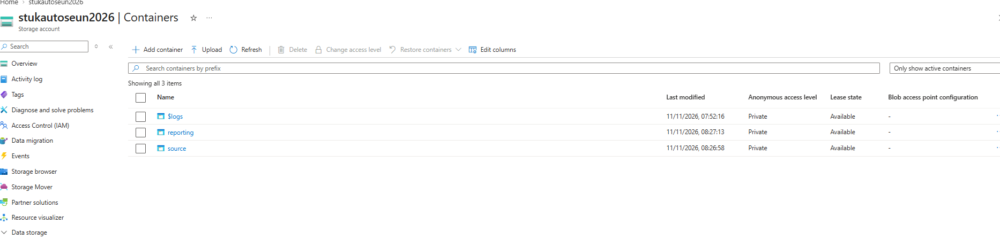
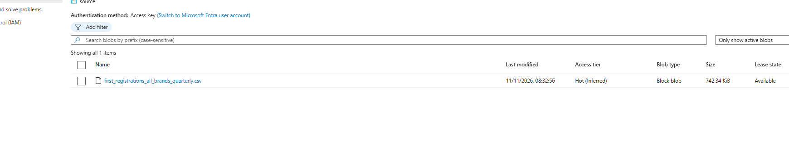
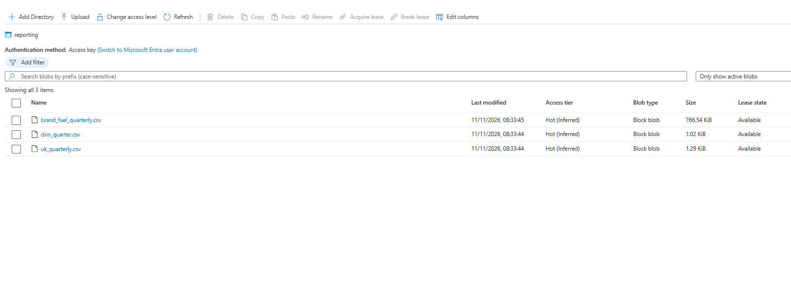

# Azure implementation
## Purpose
Azure is part of the project's intended delivery architecture: Python preparation, Azure Blob Storage, Azure SQL and Power BI. The current milestone implements cloud file storage alongside a working local database/reporting path.

## Work completed
On 11 November 2026, Azure Blob Storage was deployed and two private containers were created:
- source: the prepared make/fuel/quarter input CSV.
- reporting: the three Python reporting outputs.

The files were uploaded manually through the Azure portal. The source container holds an extracted/prepared CSV, rather than the untouched DfT download.

| Container | Blob | Size displayed in portal | Last modified displayed, 11 November 2026 |
|---|---|---:|---|
| source | first_registrations_all_brands_quarterly.csv | 742.34 KiB | 08:32:56 |
| reporting | brand_fuel_quarterly.csv | 766.54 KiB | 08:33:45 |
| reporting | dim_quarter.csv | 1.02 KiB | 08:33:44 |
| reporting | uk_quarterly.csv | 1.29 KiB | 08:33:44 |

The portal container listing shows anonymous access level Private for source and reporting. Upload listings show Block blob, Hot (Inferred) and Available lease state. These are development-time observations, not a fresh live check of the Azure account.

## Evidence
The project retains three original Azure portal screenshots from 11 November 2026:
- 08:27:31: container listing, including source and reporting with Private anonymous access.
- 08:37:55: source container showing its uploaded input CSV.
- 08:37:20: reporting container showing the three output CSVs.

The following original screenshots document the development milestone. They are preserved unchanged and show the recorded portal state on 11 November 2026, rather than a fresh live inspection.

### Private containers

### Prepared input uploaded to source

### Reporting outputs uploaded

## Implemented and planned paths
| Component | Current implementation | Remaining work |
|---|---|---|
| Python preparation | Local validation and three reporting outputs | Further automation as needed |
| Azure Blob Storage | Two private containers and four manual CSV uploads | Automate upload/version handling |
| Database | Local SQL Server Express, manually imported reporting CSVs, SQL checks | Deploy Azure SQL and load validated tables |
| Power BI | Import from local SQL Server | Configure the chosen cloud connection and refresh |
| Orchestration | Manual execution and upload | Implement and test scheduling, credentials and failure handling |

The Blob copies are a cloud storage milestone. The current Power BI report does not read from Blob or Azure SQL, and the local SQL database was not populated through an automated Blob pipeline.

## Azure SQL blocker and continuation
Azure SQL deployment encountered subscription/region restrictions during attempts involving UK South, UK West and North Europe. Registration of the Microsoft.Sql resource provider was addressed, but deployment remained blocked. No Azure SQL server/database or paid subscription upgrade was completed.

Local SQL Server was used to continue validation, modelling and reporting while the cloud database work remained open. Resolving Azure deployment eligibility, implementing the cloud load and testing refresh remain part of the wider project.

## Publication boundary
The screenshots include the storage resource name, container names, blob filenames and upload details. No access-key values, secret connection strings or subscription identifiers are shown. No deployment template or cloud automation script is presented as an implemented deliverable; the storage setup and uploads were manual.
